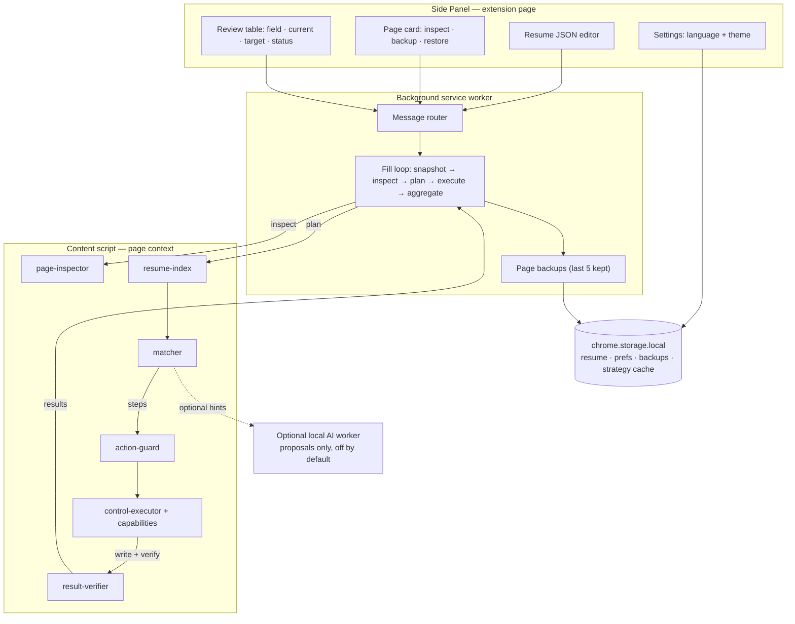
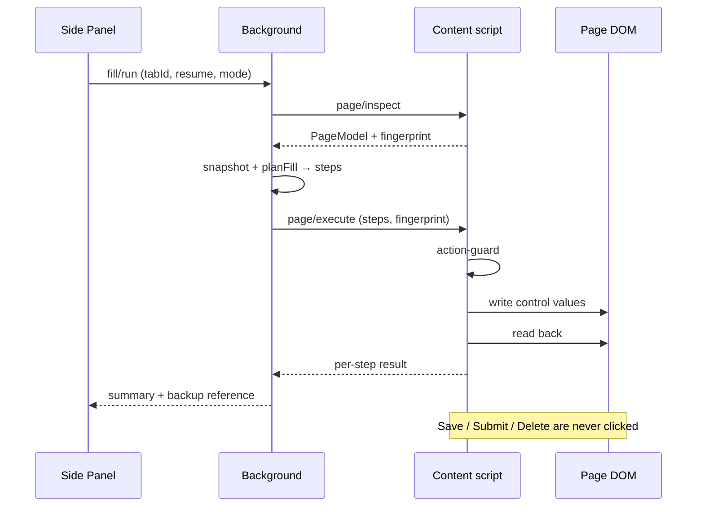

# Architecture

FormPilot is a local AI universal web runtime. The browser extension keeps the reviewable loop on the user's device:

1. The Side Panel imports a structured resume and asks the content runtime to inspect the current page.
2. The page model reports visible controls, labels, roles, options, section state, diagnostics, and a structure fingerprint. It does not contain arbitrary executable selectors or unnecessary personal values.
3. Deterministic matching and an optional local model propose tool-schema actions. Model output cannot call `chrome.*`, run JavaScript, or bypass the action guard.
4. Every proposed action is reviewed, checked against the current page identity, executed through a small control capability, then read back and verified. Failures remain explicit (`manual`, `skipped`, or `failed`) and can be retried or undone.

## System overview

`page-inspector` turns the live DOM into a **PageModel**: every control keeps its capability, section key, repeatable item index, and a structure fingerprint. `resume-index` turns the user's JSON into a **ResumeIndex**. `matcher` is deterministic and produces the step list; the optional local model may only contribute hints that are validated against those two models before use. Nothing downstream of `action-guard` can click, type into, or read outside the controls the PageModel already contains.

## One fill run

Each step re-inspects before it plans again, so a page that changes mid-run invalidates the stale plan instead of writing into shifted controls.

## Extension points

The primary extension unit is a **control capability**, not a complete site adapter. Capabilities cover reusable interaction patterns such as:

- text fields
- native selects
- custom comboboxes
- repeatable sections
- date pickers
- iframe or Shadow DOM access when the browser grants it

A validated strategy cache may contribute stable hints, but hints remain candidates until the current page fingerprint and capability versions match.

The strategy cache stores:

- locating and interaction experience
- capability versions
- provenance
- success counts
- invalidation reasons

It never stores sensitive field values. Navigation, refresh, document identity, or a structure fingerprint change invalidates the old task and cached strategy.

## Local AI boundary

No cloud multimodal model is required. A local text model may help with:

- semantic matching
- planning
- recovery

Local screenshot understanding is optional and stays on-device. When a local model is unavailable, deterministic matching, reusable control capabilities, and manual review still complete the safe parts of the workflow.

The final Submit button, CAPTCHA, login restrictions, destructive operations, and actions without an observable result have no automatic path. Cross-origin frames and closed Shadow DOM remain permission and browser capability boundaries.
